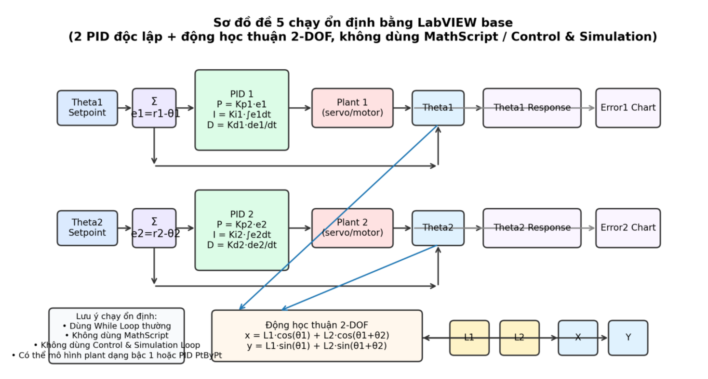
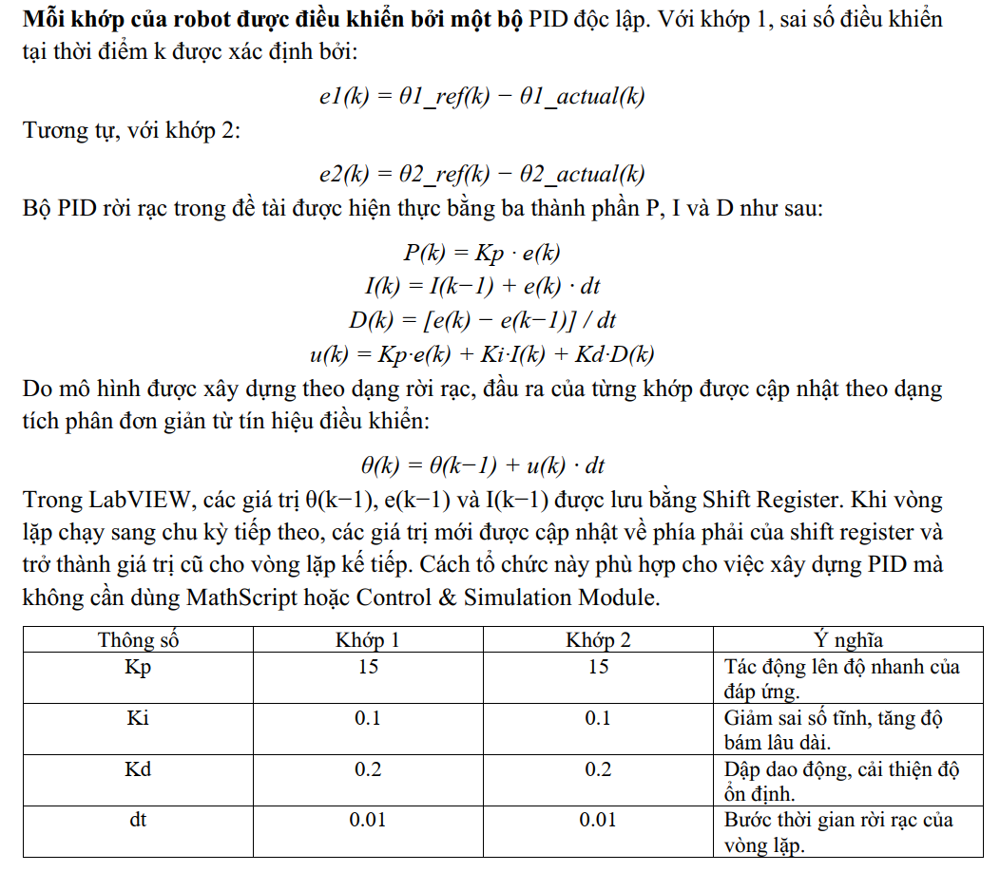
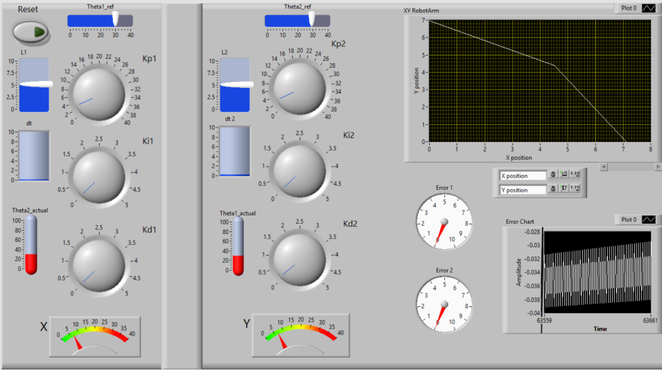
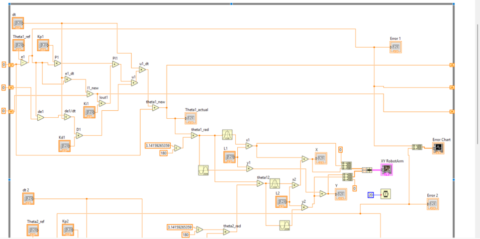
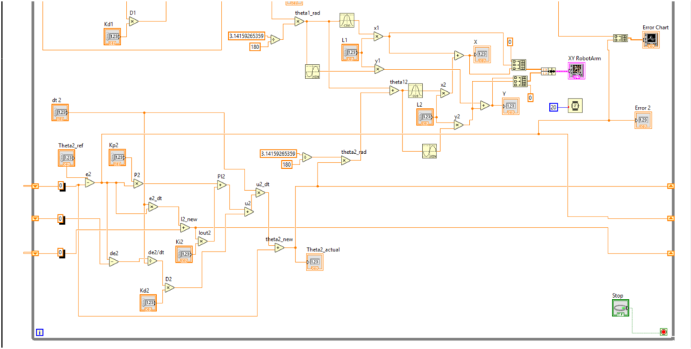
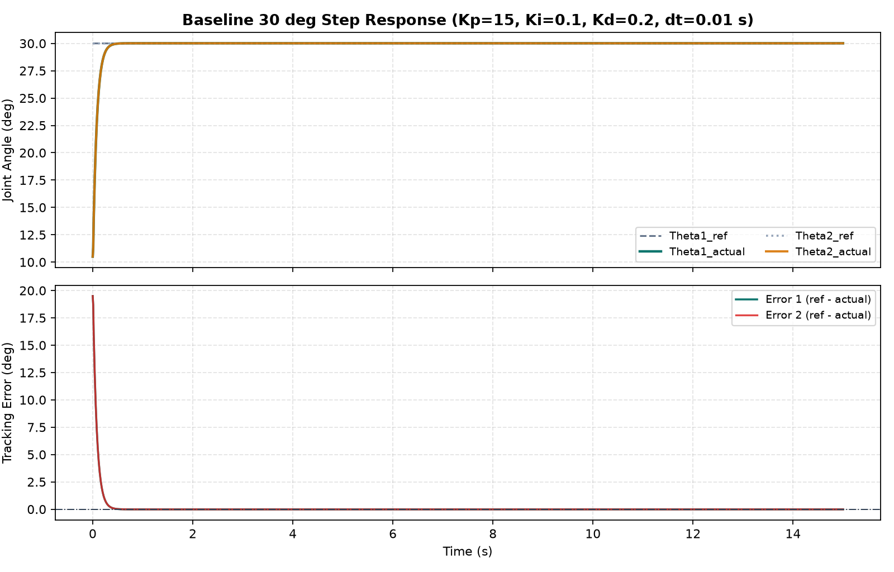
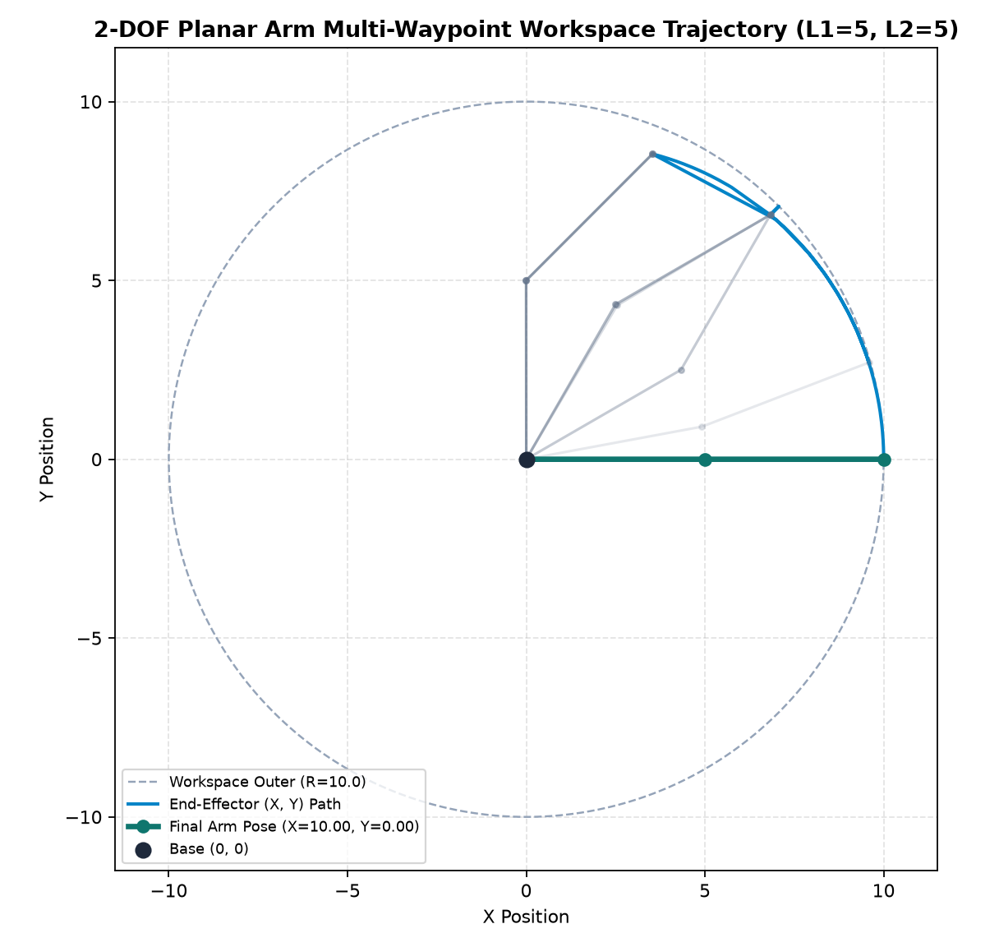
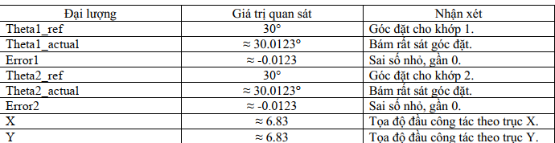

# 2-DOF Planar Arm Discrete PID Controller & Kinematics Simulator

**Dual-environment LabVIEW 22.3.7 (`FINAL2.vi`) & Python/NumPy discrete-time PID control and 2-DOF planar robotic arm forward kinematics implementation.**

> **Languages**: [English](#english) | [Tiếng Việt](#tiếng-việt)

---

<a id="english"></a>

## English

### Overview

This repository provides a complete, reproducible implementation of an independent dual-joint **discrete-time PID controller** coupled with **2-DOF planar (2R) forward kinematics**:

- **Native LabVIEW 22.3.7 Base VI**: [`labview/FINAL2.vi`](labview/FINAL2.vi) (documented in [`labview/README.md`](labview/README.md)), built purely with standard `While Loop`, `Shift Registers`, and arithmetic primitives (no MathScript or Control & Simulation Module required).
- **Python / NumPy Simulation Engine (`planar_arm_pid`)**: Bit-exact Shift-Register recurrence (`src/planar_arm_pid/`), 2-DOF forward kinematics, performance metrics (overshoot, 2%-band settling time, RMSE, IAE), headless Matplotlib figures, optional Tkinter interactive mode, and a JSON-capable CLI (`planar-arm-pid`).
- **Reproducible Benchmark Datasets**: Pre-generated trajectories in [`data/baseline_step_30deg.csv`](data/baseline_step_30deg.csv) and [`data/multi_waypoint_trajectory.csv`](data/multi_waypoint_trajectory.csv) verified against fresh simulation runs.

### Architecture & Datasets

#### 1. Discrete-Time PID Recurrence (Shift-Register Model)

For each joint $i \in \{1, 2\}$ with shift-register memory $(\theta_{\text{prev}}, e_{\text{prev}}, I_{\text{prev}})$ initialized to $(0, 0, 0)$:

$$
\begin{aligned}
e_k &= \theta_{\text{ref}} - \theta_{\text{prev}} \\
P_k &= K_p \cdot e_k \\
I_k &= I_{\text{prev}} + e_k \cdot \Delta t, \qquad I_{\text{out},k} = K_i \cdot I_k \\
D_k &= K_d \cdot \frac{e_k - e_{\text{prev}}}{\Delta t} \\
u_k &= P_k + I_{\text{out},k} + D_k \\
\theta_k &= \theta_{\text{prev}} + u_k \cdot \Delta t \\
\text{Error}_k &= \theta_{\text{ref}} - \theta_k
\end{aligned}
$$

#### 2. 2-DOF Planar Forward Kinematics

Given link lengths $L_1, L_2$ and joint angles $\theta_1, \theta_2$ (converted from degrees to radians):

$$
\begin{aligned}
x_1 &= L_1 \cos(\theta_1), & y_1 &= L_1 \sin(\theta_1) \\
X &= x_1 + L_2 \cos(\theta_1 + \theta_2), & Y &= y_1 + L_2 \sin(\theta_1 + \theta_2)
\end{aligned}
$$

The planar arm polyline is $[0, x_1, X]$ and $[0, y_1, Y]$, bounded inside the annulus $|L_1 - L_2| \le \sqrt{X^2 + Y^2} \le L_1 + L_2$.

#### 3. Baseline Benchmark Calibration (`FINAL2.vi` Parity)

With $L_1 = L_2 = 5.0$, $\theta_{1,\text{ref}} = \theta_{2,\text{ref}} = 30^\circ$, $K_p = 15.0$, $K_i = 0.1$, $K_d = 0.2$, and $\Delta t = 0.01\text{ s}$:

| Checkpoint | Time $t$ (s) | $\theta_1, \theta_2$ (deg) | $\text{Error}_1, \text{Error}_2$ (deg) | End-Effector $(X, Y)$ |
|---|---:|---:|---:|---|
| Initial step (`k = 0`) | `0.00` | `10.500300` | `+19.499700` | `(9.584153, 2.703092)` |
| Peak overshoot (`k = 115`) | `1.15` | `30.013243` | `-0.013243` | `(6.827547, 6.832283)` |
| Reference reading (`k = 1230`) | `12.30` | `30.012300` (`≈ 30.0123°`) | `-0.012300` (`≈ -0.0123°`) | `(6.827731, 6.832130)` (`≈ 6.83, 6.83`) |
| Analytical steady state ($t \to \infty$) | $\infty$ | `30.000000` | `0.000000` | `(6.830127, 6.830127)` |

#### 4. Datasets & Visual Diagrams

- [`data/baseline_step_30deg.csv`](data/baseline_step_30deg.csv): `1,501` rows ($k = 0 \dots 1500$, $t = 0.00 \dots 15.00\text{ s}$) for the $30^\circ$ dual-joint step benchmark.
- [`data/multi_waypoint_trajectory.csv`](data/multi_waypoint_trajectory.csv): `1,200` rows ($4 \times 3.0\text{ s}$ phases at $\Delta t = 0.01\text{ s}$) tracking `(30°, 30°) → (60°, -30°) → (90°, -45°) → (0°, 0°)`.
- **CSV Schema**: `step, time_s, theta1_ref_deg, theta2_ref_deg, theta1_actual_deg, theta2_actual_deg, error1_deg, error2_deg, u1, u2, x1, y1, x, y`

| Reference & Simulation Diagrams | |
|---|---|
|  |  |
|  |  |
|  |  |
|  |  |

### Installation & Usage

Requires **Python 3.10+** (`numpy>=1.24`, `matplotlib>=3.7`).

```bash
pip install -e ".[dev]"
```

Run via either the installed `planar-arm-pid` console script or `python -m planar_arm_pid`:

```bash
# Run the calibrated 30 deg baseline benchmark (JSON summary)
planar-arm-pid benchmark --json

# Verify committed CSV datasets against fresh deterministic simulations
planar-arm-pid verify-datasets --data-dir data --json

# Run a custom dual-joint step response and export CSV + PNG plots
planar-arm-pid simulate --theta1 45 --theta2 -30 --l1 5 --l2 5 --kp 15 --ki 0.1 --kd 0.2 --duration 10 --out-csv outputs/custom.csv --out-plot-dir outputs/plots --json

# Run the 4-phase multi-waypoint trajectory
planar-arm-pid waypoints --out-csv outputs/waypoints.csv --out-plot-dir outputs/wp_plots --json

# Render plots from any saved trajectory CSV
planar-arm-pid plot --input-csv data/baseline_step_30deg.csv --out-dir outputs/replot --prefix baseline --json

# Optional Tkinter interactive tuning GUI (requires desktop display)
planar-arm-pid interactive
```

### Automated Tests

Run the full offline `pytest` suite (requires no LabVIEW runtime or display server):

```bash
python -m pytest -v
```

Coverage spans 5 test modules:
- `tests/test_pid.py` — Exact first-step LabVIEW recurrence, Shift-Register `reset()`, zero gains, negative targets, `dt`/`NaN`/`Inf` validation.
- `tests/test_kinematics.py` — Analytical 2-DOF FK poses, `link_polyline`, workspace bounds, invalid link lengths.
- `tests/test_simulator_and_datasets.py` — `1501`-step benchmark (`30.0123°`, `(6.83, 6.83)` at `k=1230`), `600 s` asymptotic convergence, independent joint gains, mid-run reset, `1200`-row multi-waypoint tracking, and CSV round-trip verification.
- `tests/test_plotting_and_cli.py` — Headless `Agg` PNG generation and subprocess CLI verification (`benchmark`, `simulate`, `waypoints`, `plot`, `verify-datasets`).
- `tests/test_assets_and_hygiene.py` — `FINAL2.vi` SHA-256 + zlib control verification, PNG integrity, bilingual README rubric & link checks, and privacy/hygiene scans.

---

<a id="tiếng-việt"></a>

## Tiếng Việt

### Tổng quan

Kho lưu trữ này hiện thực hoàn chỉnh hệ thống **điều khiển PID rời rạc hai khớp độc lập** kết hợp **động học thuận cánh tay robot phẳng 2 bậc tự do (2-DOF)**:

- **VI gốc trên LabVIEW Base 22.3.7**: [`labview/FINAL2.vi`](labview/FINAL2.vi) (chi tiết trong [`labview/README.md`](labview/README.md)), xây dựng thuần bằng `While Loop`, `Shift Register` và các khối toán học cơ bản (không cần MathScript hay Control & Simulation Module).
- **Thư viện mô phỏng Python / NumPy (`planar_arm_pid`)**: Tái hiện chính xác từng bước phương trình sai phân Shift-Register (`src/planar_arm_pid/`), động học thuận 2-DOF, bộ chỉ số đánh giá đáp ứng (độ vọt lố, thời gian xác lập 2%, RMSE, IAE), vẽ đồ thị Matplotlib không cần màn hình, chế độ giao diện Tkinter tùy chọn và CLI hỗ trợ JSON (`planar-arm-pid`).
- **Bộ dữ liệu tái lập được**: Hai tệp CSV chuẩn [`data/baseline_step_30deg.csv`](data/baseline_step_30deg.csv) và [`data/multi_waypoint_trajectory.csv`](data/multi_waypoint_trajectory.csv) khớp trực tiếp với kết quả mô phỏng.

### Kiến trúc & Dữ liệu

#### 1. Thuật toán PID rời rạc (mô hình Shift Register)

Với mỗi khớp $i \in \{1, 2\}$ lưu trạng thái $(\theta_{\text{prev}}, e_{\text{prev}}, I_{\text{prev}})$ khởi tạo bằng $(0, 0, 0)$:

1. $e_k = \theta_{\text{ref}} - \theta_{\text{prev}}$
2. $P_k = K_p \cdot e_k$
3. $I_k = I_{\text{prev}} + e_k \cdot \Delta t$, $I_{\text{out},k} = K_i \cdot I_k$
4. $D_k = K_d \cdot (e_k - e_{\text{prev}}) / \Delta t$
5. $u_k = P_k + I_{\text{out},k} + D_k$
6. $\theta_k = \theta_{\text{prev}} + u_k \cdot \Delta t$
7. $\text{Error}_k = \theta_{\text{ref}} - \theta_k$

#### 2. Động học thuận cánh tay phẳng 2-DOF

Với chiều dài hai khâu $L_1, L_2$ và hai góc khớp $\theta_1, \theta_2$ đổi sang radian:

- Khuỷu tay: $x_1 = L_1 \cos(\theta_1)$, $y_1 = L_1 \sin(\theta_1)$
- Đầu công tác: $X = x_1 + L_2 \cos(\theta_1 + \theta_2)$, $Y = y_1 + L_2 \sin(\theta_1 + \theta_2)$
- Đường gấp khúc hiển thị trên mặt phẳng XY: $[0, x_1, X]$ và $[0, y_1, Y]$.

#### 3. Kết quả chuẩn đối chiếu LabVIEW (`L1 = L2 = 5`, `Theta_ref = 30°`, `Kp = 15`, `Ki = 0.1`, `Kd = 0.2`, `dt = 0.01 s`)

- **Bước đầu tiên (`k = 0`, $t = 0.00\text{ s}$)**: $\theta = 10.500300^\circ$, $\text{Error} = +19.499700^\circ$.
- **Đỉnh vọt lố (`k = 115`, $t = 1.15\text{ s}$)**: $\theta = 30.013243^\circ$, $\text{Error} = -0.013243^\circ$.
- **Điểm đối chiếu báo cáo (`k = 1230`, $t = 12.30\text{ s}$)**: $\theta_1 = \theta_2 = 30.012300^\circ$ (`≈ 30.0123°`), $\text{Error}_1 = \text{Error}_2 = -0.012300^\circ$ (`≈ -0.0123°`), $X = 6.827731 \approx 6.83$, $Y = 6.832130 \approx 6.83$.

#### 4. Bộ dữ liệu CSV & Hình ảnh

- [`data/baseline_step_30deg.csv`](data/baseline_step_30deg.csv): `1.501` dòng ($k = 0 \dots 1500$, $0 \dots 15.00\text{ s}$) cho bài toán đáp ứng bước $30^\circ$.
- [`data/multi_waypoint_trajectory.csv`](data/multi_waypoint_trajectory.csv): `1.200` dòng (4 giai đoạn $\times 3.0\text{ s}$) bám quỹ đạo điểm đặt `(30°, 30°) → (60°, -30°) → (90°, -45°) → (0°, 0°)`.
- Các biểu đồ trong [`docs/images/`](docs/images/sim_baseline_step_response.png) gồm sơ đồ khối hệ thống, công thức PID rời rạc, giao diện Front Panel, Block Diagram (`PID 1`, `PID 2`), bảng số liệu đối chiếu (`06_labview_simulation_table.png`, `07_pid_gain_tuning_notes.png`) và 2 đồ thị Matplotlib tái lập trực tiếp từ mã nguồn Python.

### Cài đặt & Sử dụng

Yêu cầu **Python 3.10+** (`numpy>=1.24`, `matplotlib>=3.7`):

```bash
pip install -e ".[dev]"
```

Chạy kiểm tra chuẩn, đối soát dữ liệu CSV và xuất đồ thị qua CLI:

```bash
python -m planar_arm_pid benchmark --json
python -m planar_arm_pid verify-datasets --data-dir data --json
python -m planar_arm_pid simulate --theta1 45 --theta2 -30 --duration 10 --out-csv outputs/sim.csv --out-plot-dir outputs/plots --json
python -m planar_arm_pid waypoints --out-csv outputs/wp.csv --out-plot-dir outputs/wp_plots --json
```

### Kiểm thử tự động

Chạy toàn bộ bộ kiểm thử `pytest` hoàn toàn ngoại tuyến (không cần cài LabVIEW hay màn hình đồ họa):

```bash
python -m pytest -v
```

Tất cả kiểm thử bao phủ từ phương trình sai phân Shift-Register, động học thuận 2-DOF, kiểm chứng hội tụ và tái lập dữ liệu CSV, sinh ảnh PNG, thực thi CLI cho đến kiểm tra tính toàn vẹn tệp `FINAL2.vi` và rà soát sạch dữ liệu.
